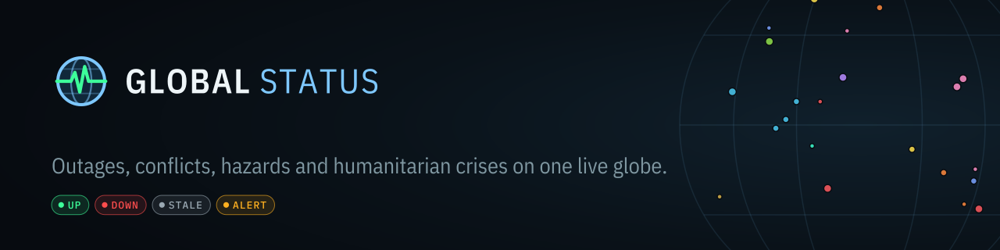
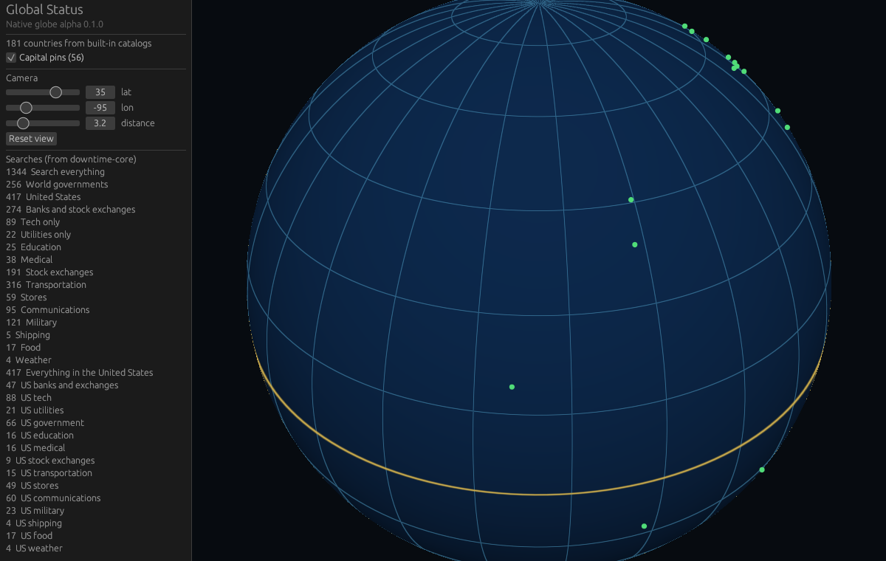

# Downtime Checker / Global Status

Global Status ([globalstatus.app](https://globalstatus.app)) is a free and open-source world-status globe. This repository holds the web globe, the original Downtime CLI, and the native Rust apps.

Downtime checks whether public websites answer, then prints each result on one line.

## How it works

1. Open Downtime from the desktop icon, the application menu, or `python3 downtime.py`.
2. Pick a numbered search. `0` quits. On a submenu, `0` or `b` goes back.
3. For each place, the checker pings the website name. If ping stays silent, it tries TCP port 443, then port 80.
4. A place is UP when ping or either port answers. Otherwise it is DOWN.
5. Each result prints as soon as that place finishes: UP or DOWN, the name, the address, and the location.
6. Down places are listed again in a short block. The full results are then grouped by country, then by state. The country name is drawn large when `figlet` is installed. Blank lines separate countries.
7. The footer shows how many places were checked, how many are online, how many are offline, and which countries were in that search.

Catalog files store a sample IP next to each site. That IP is not what gets pinged. The checker uses the website name, because addresses change.

Location is where the address answers from, often a content network rather than the office. Lookups use ipwho.is and are saved in `locations.json` next to the program.

## Menu

1. Search everything
2. World governments
3. United States (opens a second menu limited to United States sites)
4. Banks and stock exchanges
5. Tech only (company sites and individual services such as Microsoft 365, Azure, Xbox, Google Drive, and AWS)
6. Utilities only
7. Education
8. Medical
9. Stock exchanges
10. Transportation
11. Stores
12. Communications (TV, phone, radio, cell, and internet)
13. Military (defense ministries and armed forces sites)
14. Shipping
15. Food
16. Weather
17. Choose a country (world government sites; United States opens the United States menu)
18. Add a place (a name plus an IP or web address, saved for later searches)

## Requirements

Python 3 and `ping`. Optional: `figlet` for large country names, and `qterminal` for the desktop launcher. Without `qterminal`, the launcher opens in the default terminal.

## Install

Python 3 must already be installed. The installer does not use the network and does not need root.

From a clone of this repository:

```bash
bash install.sh
```

That copies the program to `~/bin/downtime`, puts a Downtime icon on the Desktop, and adds it to the application menu. If a Pentesting folder is already on the Desktop, the launcher is placed there too.

An offline archive is `Downtime Checker.tar.gz`. The steps to install it from a terminal are in `INSTALL.txt`.

## Run without installing

```bash
python3 downtime.py
```

## Live visualizer (Node)

A globe dashboard that runs the same catalogs, ping + TCP 443/80 checks, and location cache as the Python CLI.

```bash
cd visualizer
node server.mjs
```

Open http://127.0.0.1:4173 — pick a mission, watch nodes light up as they answer.

## Cesium globe

The same server also serves a CesiumJS globe at http://127.0.0.1:4173/cesium.html. It uses the same catalogs, ping and TCP checks, and location cache. Search lines arc from the same central point as the canvas globe. It does not need a Cesium ion key. The first open downloads Cesium from cesium.com.

Basemaps are free public tiles, no API keys:

- SAT: EOX Sentinel-2 cloudless 2025, 10 m global mosaic ([s2maps.eu](https://s2maps.eu)), proxied at `/tiles/eox/{z}/{y}/{x}.jpg` so Cesium can texture the globe (EOX CORS is credentialed). 2018–2025 mosaics are CC BY-NC-SA; a public ad-supported site needs an EOX commercial license or the 2016 CC BY mosaic.
- LIVE: NASA GIBS VIIRS SNPP true color (today's Earth, clouds included)
- NIGHT: NASA Black Marble
- STREETS: OpenStreetMap raster tiles
- LABELS: NASA GIBS place names over satellite
- 3D: Mapzen / AWS Open Data Terrarium DEM (SRTM, GMTED, NED). Right-drag tilts so mountains stand up.

Credits stay on the globe. Overlay pins do not hide behind terrain.

Uniden BearTracker 885 radio sites load as a gold overlay from `MasterHpdb_*.gz`. If that file is already in `~/Downloads/BT885_radio_database` (or `BT885_HPDB` / `BT885_HPDB_DIR`), it is used as-is. Otherwise, when `BT885_FTP_USER` and `BT885_FTP_PASS` are set (the BT885 Update Manager login; it is not committed), the server pulls the latest dump from the same FTP the official BT885 Update Manager uses (`ftp.uniden.com/BT885`), caches it under `~/.cache/downtime/hpdb` (or `/tmp/downtime-hpdb` on Fly), and derives the globe pins from C-Group/Site rows. Set `BT885_FTP=0` to disable the fetch. RADIO browses United States states and Canadian provinces, then counties, parishes, boroughs, and municipalities under those. Click a region for its agencies, then a site for name and sample frequencies. WebSDR pins still open the receiver.

## Offline local clients

The public globe stays live. A laptop or mesh node can run the same server from a data pack with no network.

Overlays load pack → cache → network. `OFFLINE=1` stops at pack/cache. SAT tiles the proxy has already fetched stay on disk. Live AIR/AIS/JAM use the last `feeds.json` snapshot.

```bash
cd visualizer
node lib/datapack.mjs snapshot
node lib/datapack.mjs vendor-cesium
OFFLINE=1 node server.mjs
```

`GET /api/ready` reports what is packed. `DATA_DIR` points the pack at another folder. See [visualizer/data/README.md](visualizer/data/README.md).

Live scanner streams are scraped from Broadcastify state/county listen pages (plus radio-browser and OpenMHz when those APIs answer) and matched onto HPDB counties. Broadcastify `ctid` is the same county id as the Uniden database. Purple STREAM pins open the public listen page. The catalog caches for 12 hours under `~/.cache/downtime/hpdb-streams.json`.

Cesium also pulls live overlays:

- GPS jam zones from [gpsjam.org](https://gpsjam.org/) (daily H3 grid, satellite pins; click opens the map). Live GPSInterference dots remain on the JAM toggle.
- Aircraft from [adsb.lol](https://adsb.lol) public v2 (military, LADD, PIA, 7700, 250 nm circles; same readsb fields as globe.adsb.lol), not ADS-B Exchange. Unkeyed cap is 500/day. A local 1090 MHz feeder is documented in [wiki/ADS-B-IM-Feeder.md](wiki/ADS-B-IM-Feeder.md) ([adsb.im/howto](https://adsb.im/howto)); that box is not built yet. Optional `ADSB_LOL_API_KEY` and `ADS_B_FEEDER_URL`.
- Ships from Digitraffic AIS
- Conflicts from the [CFR Global Conflict Tracker](https://www.cfr.org/global-conflict-tracker) (bomb pins with status; click opens the briefing)

Wiki index: [wiki/Home.md](wiki/Home.md).

`bash install.sh` adds Downtime UI and Downtime Cesium launchers in `Desktop/Pentesting` when that folder already exists, and in the application menu. Node.js is required for both globes.

## Rust native apps (alpha)

The native wgpu globe is the product renderer and has to **succeed Cesium in every way**. Cesium (`globalstatus/`) stays the live web globe until that bar is met; then the web target is the same Rust globe. Native Android, Linux, macOS and Windows apps live under [`rust/`](rust/): shared core, `downtime` CLI, SSE server, wgpu + egui globe (`cargo run -p downtime-globe-native`). Phases and the Cesium-parity bar: [docs/rust-native.md](docs/rust-native.md). Source inventory (port / rewrite / defer / delete): [docs/globe-plan/RUST_PLAN.md](docs/globe-plan/RUST_PLAN.md), `python3 scripts/globe-re/globe_plan.py`. Mapbox GL JS is refused; Cesium `Core/` ports stay Apache-2.0 with [NOTICE-CESIUM](NOTICE-CESIUM).



Alpha builds for Linux (tar.gz, AppImage), Windows (zip), macOS (universal zip/dmg) and Android (APK) are on the [Releases](https://github.com/lquessenberry/downtime-checker/releases) page with `SHA256SUMS`. They are **not code-signed yet**: macOS Gatekeeper and Windows SmartScreen will warn on first launch. How releases are cut, and the F-Droid metadata: [docs/RELEASING.md](docs/RELEASING.md).

## Working an issue

See [CONTRIBUTING.md](CONTRIBUTING.md). Feature work is a **GitHub PR on this fork** into `feat/globalstatus-prod`. Do not STOR day-to-day edits to FTP.

Pick an issue. The agent (or Will) opens a branch, commits, and opens a PR. **Deploy to staging** publishes https://downtime-globe.fly.dev. **Go live** is a separate FTP push to https://globalstatus.app (Action dry-run default). Tracker: [#2](https://github.com/lquessenberry/downtime-checker/issues/2).

## Staging (Fly.io) and production (globalstatus.app)

**Staging** is the Node globe on Lee's Fly account. **Production** is the live FTP tree on GoDaddy, snapshot in [`globalstatus/`](globalstatus/).

```bash
# staging
scripts/deploy-staging-fly.sh

# production (needs ~/.config/globalstatus/netrc or GLOBALSTATUS_FTP_PASS)
python3 scripts/ftp_prod.py push --dry-run
python3 scripts/ftp_prod.py push
python3 scripts/ftp_prod.py pull
```

GitHub Actions on this fork (`lquessenberry/downtime-checker`) stores the globalstatus.app FTP login from Will's email as **environment secrets** on `production`. Run **Actions → Deploy production FTP** (`workflow_dispatch`). Leave **dry-run** on unless you mean to write the live site.

| Name | Kind | From Will's email |
| --- | --- | --- |
| `GLOBALSTATUS_FTP_HOST` | secret | FTP host |
| `GLOBALSTATUS_FTP_PORT` | secret | FTP port |
| `GLOBALSTATUS_FTP_USER` | secret | FTP username |
| `GLOBALSTATUS_FTP_PASS` | secret | Password (never commit) |
| `GLOBALSTATUS_FTP_PASV` | variable | Mode passive (`1`) |
| `GLOBALSTATUS_FTP_PROTOCOL` | variable | Protocol `FTP` |
| `GLOBALSTATUS_SITE_URL` | variable | `https://globalstatus.app` |
| `GLOBALSTATUS_CPANEL_URL` | variable | Panel address (no password was in the email) |
| `GLOBALSTATUS_CPANEL_USER` | variable | cPanel user |

Do not store church FTP logins. Fork PRs cannot use these secrets on `willlccasey/downtime-checker`.

Static overlay JSON (WebSDR, gpsjam.org, CFR conflicts, Broadcastify streams, Uniden RADIO, host catalog) is refreshed by **Actions → Refresh static data**. Cron: overlays twice daily, streams daily, radio weekly. The fork default branch is `feat/globalstatus-prod` so those schedules run. Live AIR/AIS/JAM/outages are not written to git. Source table: [docs/DATA-SOURCES.md](docs/DATA-SOURCES.md).

```bash
node scripts/refresh_static_data.mjs overlays
node scripts/refresh_static_data.mjs streams
node scripts/refresh_static_data.mjs radio
```

PHP globe staging (Will's `globalstatus/` tree, disease layers, etc.): https://globalstatus-stage.fly.dev — `fly deploy -c fly.gsa.toml --ha=false`

Node globe staging: https://downtime-globe.fly.dev — `/` is the Cesium globe, `/index.html` is the canvas grid, `/healthz` is the health check.

Production URL: https://globalstatus.app — static files plus `router.php` for `/api`. The FTP login must show remote folder `/` and must not show a church site.

The Fly container binds `0.0.0.0:8080`. Catalog scans from the public host wait 15 seconds between runs. Uniden RADIO stays empty unless `BT885_HPDB` is mounted; STREAM pins that already have coordinates still load. Optional secrets: `ADSB_LOL_API_KEY`, `ADS_B_FEEDER_URL`, `AISSTREAM_API_KEY`. Do not bake keys into the image. Do not commit FTP passwords.

## License

Global Status is free and open source, dual-licensed under either of

- [MIT license](LICENSE-MIT)
- [Apache License, Version 2.0](LICENSE-APACHE)

at your option (`MIT OR Apache-2.0`). Copyright Lee Quessenberry, Will Casey, and Global Status contributors. Unless you say otherwise, any contribution you submit for inclusion is dual-licensed the same way, without extra terms.

Vendored third-party code keeps its own license (CesiumJS in `globalstatus/vendor/cesium/` and h3-js in `visualizer/lib/vendor/` are Apache-2.0). Data feeds and layers keep their own terms and attribution; see [docs/DATA-SOURCES.md](docs/DATA-SOURCES.md). Licensed data such as RadioReference is linked, never copied.
